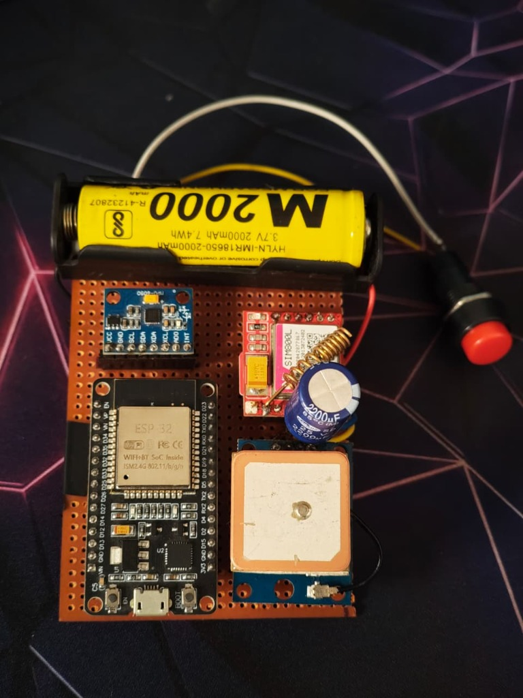
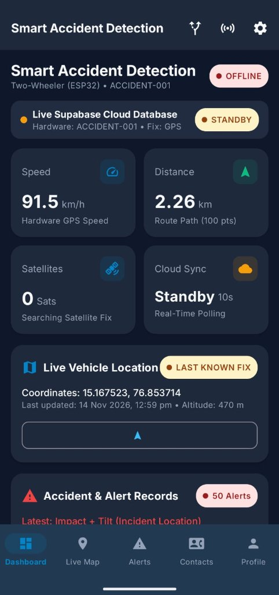
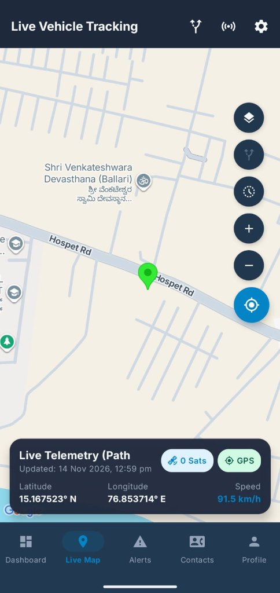
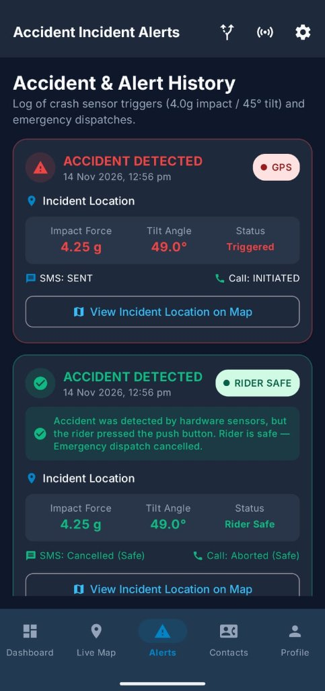
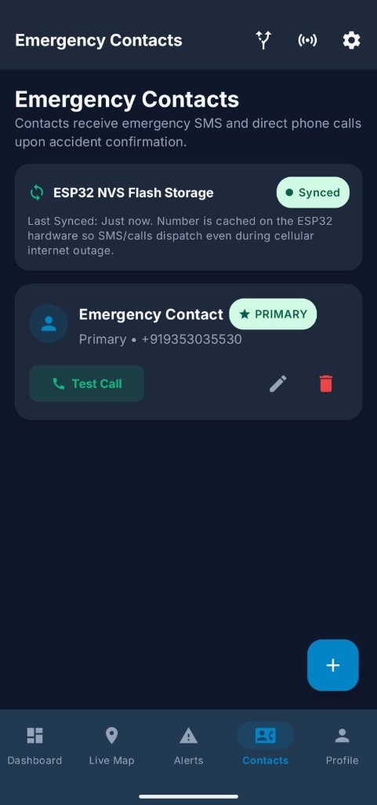

# 🚨 Smart Accident Detection & Emergency Alert System

[](https://www.espressif.com/)
[](https://developer.android.com/jetpack/compose)
[](https://supabase.com/)
[](https://kotlinlang.org/)
[](LICENSE)

An intelligent, IoT-enabled motorcycle and vehicle safety system designed to automatically detect collisions and falls, prevent false alarms through an interactive countdown, and immediately alert emergency contacts with real-time GPS coordinates via SMS, automated voice calls, and a companion Android application connected to a live cloud database.

---

## 📌 Table of Contents
- [Hardware Prototype Device](#-hardware-prototype-device)
- [Android Mobile Application](#-android-mobile-application)
- [System Architecture](#-system-architecture)
- [Key Features](#-key-features)
- [Hardware Components & Pinout](#-hardware-components--pinout)
- [Repository Structure](#-repository-structure)
- [Prerequisites & Libraries](#-prerequisites--libraries)
- [Security & Environment Variables](#-security--environment-variables)
- [License](#-license)

---

## 🛠 Hardware Prototype Device

The embedded hardware unit is powered by an ESP32 microcontroller integrated with motion and cellular positioning modules on a compact, portable veroboard chassis:

<p align="center">
  
</p>

### Highlighted Onboard Modules:
- **ESP32 Dev Module**: Dual-core processor handling sensor fusion, tilt computation, and telemetry dispatch.
- **MPU-6050 6-Axis IMU**: Real-time 3D spherical tilt angle tracking (>45°) and impact detection (>5.0g).
- **SIM800L GSM/GPRS**: 2G cellular transceiver with 2200µF buffer capacitor for automated emergency SMS, voice calls, and GPRS cloud transmission.
- **NEO-6M GPS Module**: Dedicated ceramic patch antenna for high-accuracy latitude, longitude, and speed tracking.
- **18650 Li-ion Battery (3.7V / 2000mAh)**: Autonomous, high-drain mobile power supply.
- **Emergency Cancel Push Button**: Momentary tactile button allowing the rider to abort false alarms within a 15-second grace period.

---

## 📱 Android Mobile Application

The companion Android application is built with **Jetpack Compose** and **Material Design 3**, communicating directly with Supabase Cloud for live telemetry and alert management:

| Dashboard | Live Vehicle Tracking | Accident Alerts & History | Emergency Contacts |
|:---:|:---:|:---:|:---:|
|  |  |  |  |
| **Real-time Telemetry & Status**<br>Speed, distance, satellite count, and connectivity state. | **Interactive GPS Map**<br>Google Maps route polyline, live vehicle pin, and speed tracking. | **Crash & Fall Audit Log**<br>Impact force, tilt angle, and Rider Safe button cancellation records. | **Cloud-Synced Contacts**<br>Primary emergency numbers synchronized with ESP32 NVS memory. |

---

## 🏗 System Architecture

```
                    +------------------------+
                    |  Vehicle Sensors / IMU |
                    |  MPU-6050 & NEO-6M GPS |
                    +-----------+------------+
                                |
                                v
                    +------------------------+
                    |    ESP32 Controller    |
                    | (Detection & Decision) |
                    +----+--------------+----+
                         |              |
             [45° Tilt / Impact]   [15s Countdown]
                         |              | (Cancel via Button)
                         v              v
        +----------------+--+      +----+---------------+
        | SIM800L GSM/GPRS  |      |   Wi-Fi / GPRS     |
        +---+------------+--+      +---------+----------+
            |            |                   |
            v            v                   v
      [Emergency   [Emergency        [Supabase Cloud]
         SMS]         Call]                  |
                                             v
                                  +---------------------+
                                  | Android Mobile App  |
                                  | (Live Map & Alerts) |
                                  +---------------------+
```

---

## ✨ Key Features

1. **Precision Fall & Impact Detection**:
   - **Vector Spherical Tilt Detection**: Continuously computes roll and pitch angles; triggers when the vehicle sustains a tilt greater than **45°** for more than 400ms.
   - **G-Force Impact Detection**: Detects severe kinetic deceleration/impacts exceeding **5.0g**.
2. **False Alarm Cancellation Mechanism**:
   - High-pitch buzzer alert with a **15-second countdown** upon detection.
   - Push button on **GPIO 33** allows the rider to cancel the alert if uninjured, dispatching a "Rider Safe / False Alarm" status to the cloud.
3. **Emergency Cellular Alerts (SIM800L)**:
   - **Automated SMS**: Dispatches an emergency SMS containing exact Google Maps coordinates (`https://maps.google.com/?q=lat,lon`), impact force, and tilt angle.
   - **Automated Voice Call**: Initiates a phone call to the primary emergency contact.
4. **Dual-Path Cloud Telemetry**:
   - Supports 2G/GPRS cellular data and Wi-Fi to synchronize 10-second live telemetry (`locations`) and collision reports (`accidents`) to Supabase.
5. **Modern Android Companion App**:
   - Built with **Jetpack Compose** and **Material Design 3**.
   - Live Google Maps real-time tracking and route polyline display.
   - Incident history logs, device status monitoring, and cloud-synced emergency contacts.

---

## 🔌 Hardware Components & Pinout

### Required Components:
- **ESP32 Dev Module** (Dual-Core 240MHz, 4MB Flash)
- **MPU-6050** 6-Axis Accelerometer & Gyroscope
- **NEO-6M GPS Module** with Ceramic Antenna
- **SIM800L 2G GSM/GPRS Module** (with external 3.7V–4.2V Li-ion battery or 2A buck converter)
- **Active Buzzer (5V / 3.3V)**
- **Momentary Push Button** (Normally Open)
- **Common Ground** shared across all modules

### Pin Connection Table:

| Component | Component Pin | ESP32 GPIO | Description / Notes |
|---|---|---|---|
| **MPU-6050** | VCC | 3.3V / 5V | Power supply |
| | GND | GND | Common Ground |
| | SDA | **GPIO 21** | I2C Data line |
| | SCL | **GPIO 22** | I2C Clock line |
| **NEO-6M GPS** | VCC | 3.3V / 5V | Power supply |
| | GND | GND | Common Ground |
| | TX | **GPIO 16** (RX2) | Hardware UART2 Receive |
| | RX | **GPIO 17** (TX2) | Hardware UART2 Transmit |
| **SIM800L GSM** | VCC | **3.7V - 4.2V** | **External Power (Peak 2A required)** |
| | GND | GND | **Common Ground with ESP32** |
| | TX | **GPIO 18** (RX1) | Hardware UART1 Receive |
| | RX | **GPIO 19** (TX1) | Hardware UART1 Transmit |
| **Active Buzzer** | Positive (+) | **GPIO 25** | Trigger pin |
| | Negative (-) | GND | Ground |
| **Push Button** | Terminal 1 | **GPIO 33** | Internal Pull-Up (`INPUT_PULLUP`) |
| | Terminal 2 | GND | Connects to GND on press |

---

## 📁 Repository Structure

```
SmartAccidentDetection/
├── app/                                 # Android Mobile App
│   ├── src/main/java/com/example/...    # Kotlin source code (Compose, Retrofit, Repositories)
│   ├── src/main/res/                    # Android layouts, drawables, strings
│   ├── AndroidManifest.xml              # Permissions and Map API configurations
│   └── build.gradle.kts                 # App-level dependencies & build rules
├── backend/                             # Node.js Cloud Gateway (Optional)
│   ├── server.js                        # Express HTTP server
│   ├── supabaseClient.js                # Supabase REST client
│   └── package.json                     # Node dependencies
├── docs/                                # Visual Documentation & Media
│   └── images/                          # Hardware prototype & Android UI screenshots
├── firmware/                            # Embedded C++ Firmware
│   ├── smart_accident_firmware/
│   │   └── smart_accident_firmware.ino  # Main ESP32 production firmware
│   └── tests/                           # Unit tests for MPU6050, GPS, SIM800L, Buzzer
├── gradle/                              # Gradle build wrapper
├── .gitignore                           # Git ignore rules for build artifacts & secrets
├── build.gradle.kts                     # Project-level Gradle build configuration
├── local.properties.example             # Template for Android SDK and Maps API Key
└── README.md                            # Comprehensive project documentation
```

---

## 📦 Prerequisites & Libraries

### For Arduino IDE (Firmware):
- **ESP32 Board Support Package** (by Espressif Systems v2.0.x or v3.0.x)
- **TinyGPSPlus** (by Mikal Hart)
- Built-in libraries: `Wire.h`, `WiFi.h`, `HTTPClient.h`, `WiFiClientSecure.h`, `Preferences.h`

### For Android Studio:
- **Android Studio Ladybug (2024.2+)** or Hedgehog+
- **JDK 11** or **JDK 17**
- **Android SDK API 34** (minimum API 24)
- Google Maps API Key from [Google Cloud Console](https://console.cloud.google.com/)

---

## 🔒 Security & Environment Variables

> [!WARNING]
> **Before pushing to a public GitHub repository**, make sure you do NOT publish private credentials:
> 1. **Do not commit personal phone numbers or Wi-Fi passwords** in `smart_accident_firmware.ino`. Replace them with placeholders (e.g. `"YOUR_WIFI_PASSWORD"`).
> 2. **Never commit `local.properties`** or `backend/.env` (both are already protected in `.gitignore`).
> 3. Use restricted Supabase Anon keys rather than full admin service role keys in mobile and embedded clients.

---

## 📄 License
This project is open-source and licensed under the [MIT License](LICENSE).
